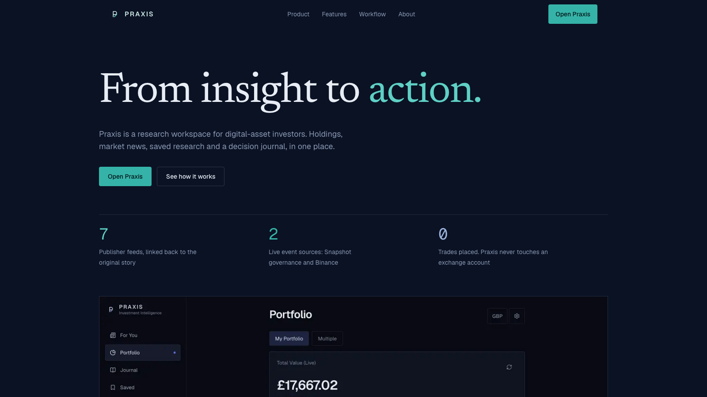
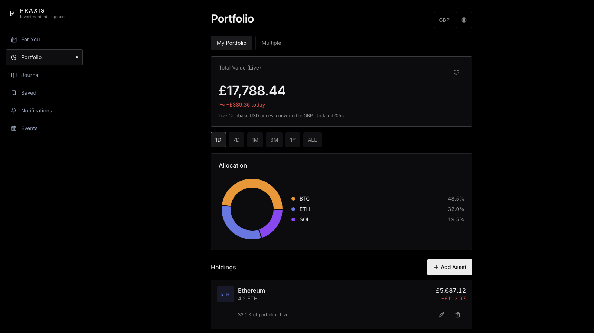
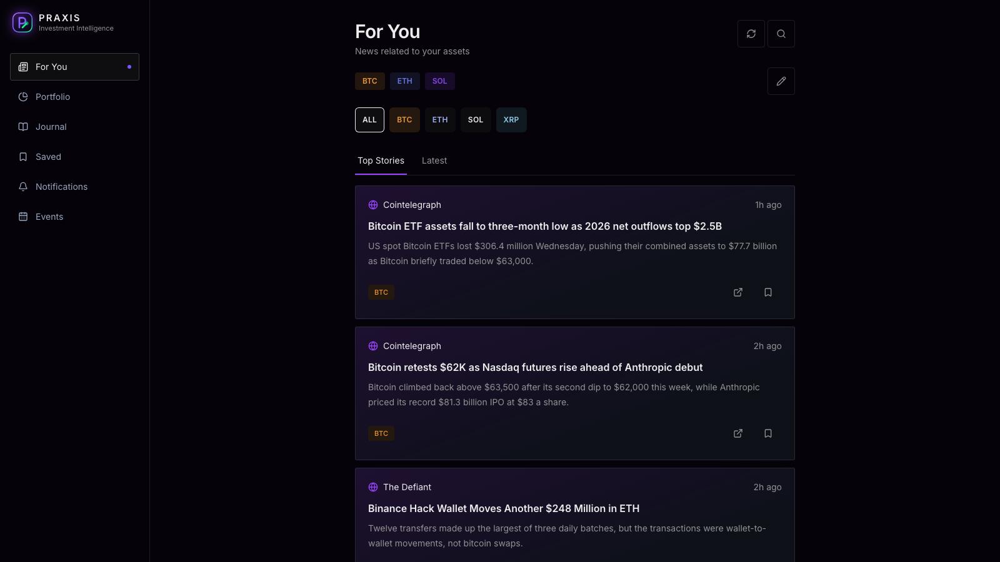
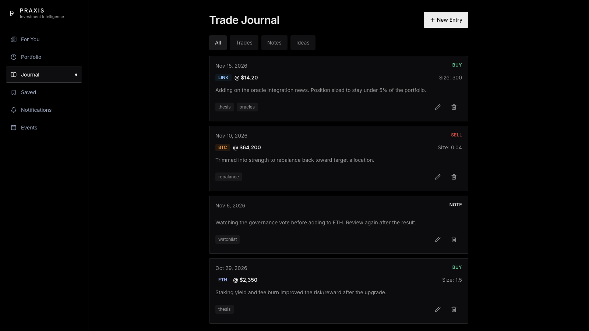
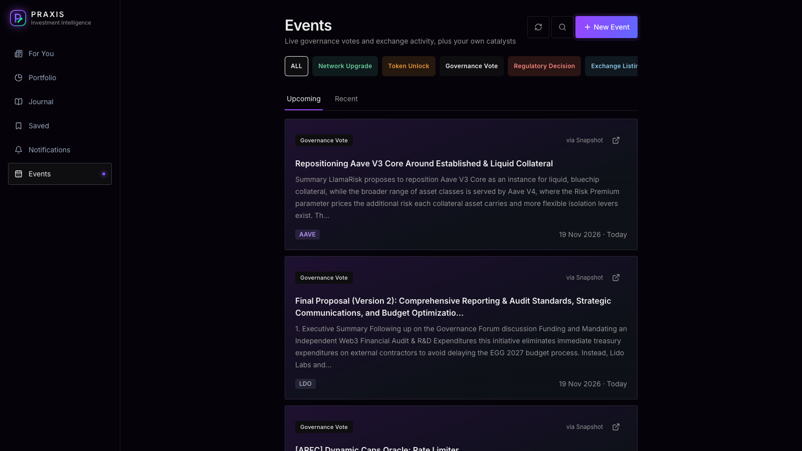
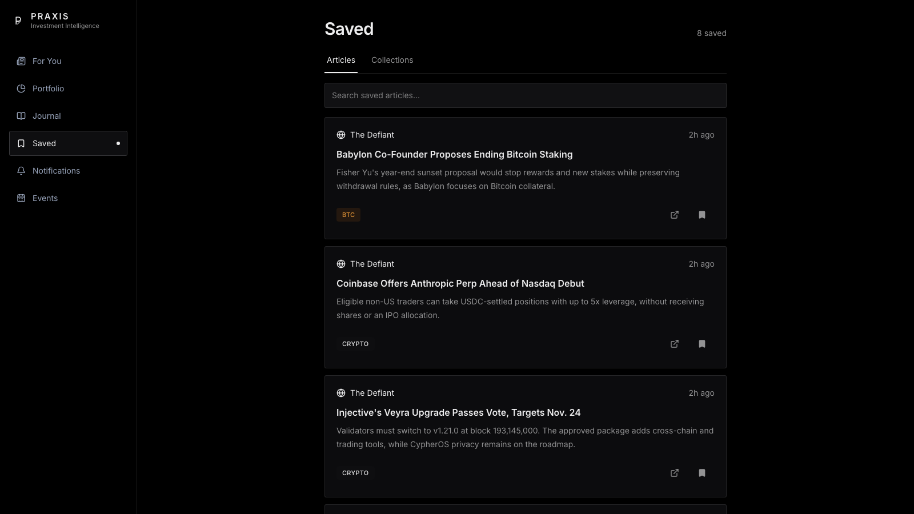
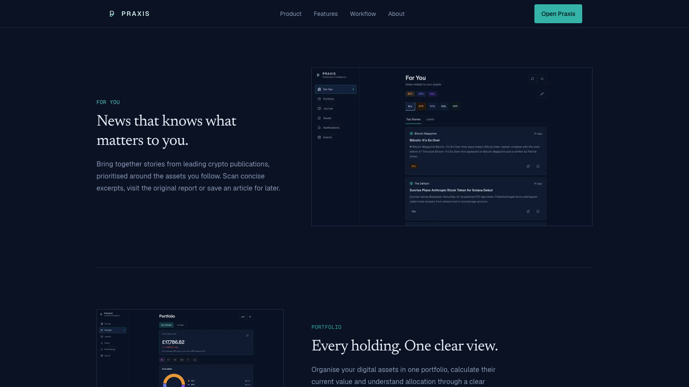
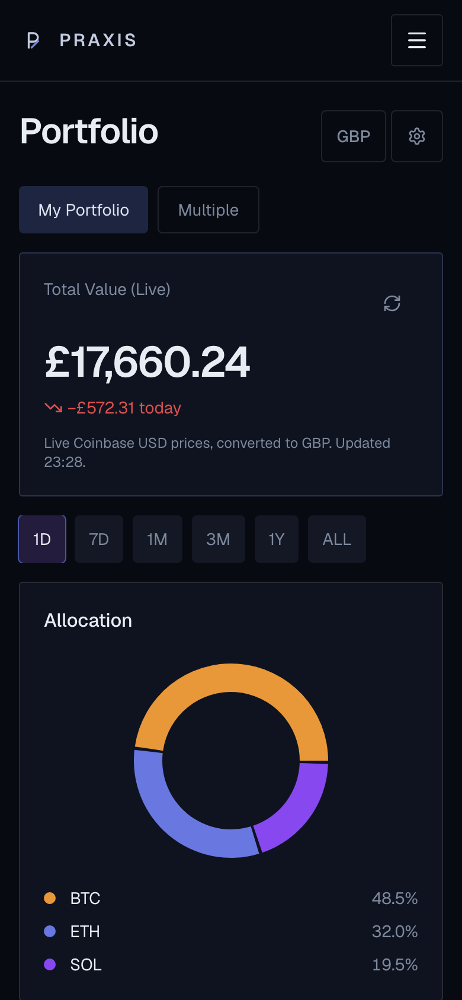
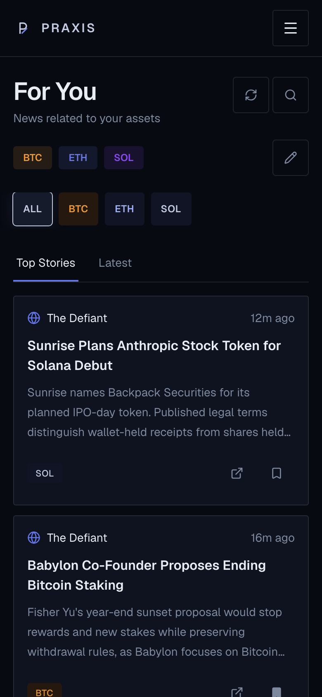
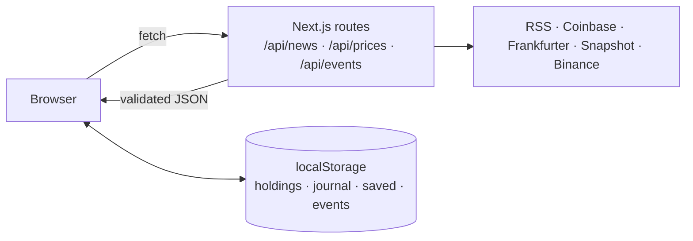

<div align="center">

# Praxis Investment Intelligence

**From insight to action. A research workspace for digital-asset investors: portfolio, live news, saved research and a decision journal in one place.**

[](https://github.com/aluinn/nexus-crypto-app-/actions/workflows/ci.yml)
[](https://github.com/aluinn/nexus-crypto-app-/actions/workflows/codeql.yml)
[](LICENSE)
[](https://github.com/aluinn/nexus-crypto-app-/stargazers)

<!-- HERO: replace this screenshot with a screen recording (GIF or MP4) of the app when you have one. -->


[Architecture](docs/ARCHITECTURE.md) · [Data sources](docs/DATA_SOURCES.md) · [Roadmap](ROADMAP.md) · [Contributing](CONTRIBUTING.md)

</div>

*Praxis* is the Ancient Greek word for action or practice: knowledge applied through informed action. Praxis brings market information, research and your own reasoning together so decisions are made with the whole picture. It is for organisation and reference. It is not financial advice, and it does not place trades.

## Features

- **Portfolio.** Track holdings and see total value, daily change, allocation and 1D / 7D / 1M / 3M / 1Y / ALL ranges, in GBP, USD, EUR, JPY, CAD or AUD. Every price is labelled `Live`, `Cached` or `Demo`.
- **For You news.** Headlines from seven publisher RSS feeds (CoinDesk, Cointelegraph, Decrypt, CryptoSlate, The Block, Bitcoin Magazine, The Defiant), tagged by asset and filterable by the assets you follow. Excerpts link back to the original story.
- **Saved research.** Save articles and arrange them into collections. Saved stories are kept in full, so they survive the live feed moving on.
- **Trade journal.** Record buys, sells, notes and ideas with price, size, tags and the reasoning behind each decision.
- **Events calendar.** Live governance votes from Snapshot and exchange listings and launches from Binance, plus your own events (upgrades, unlocks, regulatory dates), with category filters.
- **Private by design.** No accounts, no database. Holdings, journal, saved research and events stay in your browser and are validated when read.
- **Resilient.** One feed or provider failing never blanks the page. The app falls back to cached or clearly labelled demo data.

## Screenshots

| | |
| --- | --- |
| <br>**Portfolio** | <br>**For You** |
| <br>**Trade journal** | <br>**Events** |

<details>
<summary>More screenshots</summary>

| | |
| --- | --- |
| <br>**Saved research** | <br>**Landing page features** |
| <br>**Portfolio on a phone** | <br>**News on a phone** |

</details>

The portfolio and journal figures in these screenshots are demonstration data. News and events are live feeds from the day they were captured.

## How it works



1. The browser never calls a third party. Server routes fetch public data in parallel, each source with its own timeout.
2. Responses are stripped to plain text where needed, checked with Zod and cached in memory (news 12 min, events 15 min, prices 60 s).
3. Prices are fetched in USD from Coinbase and converted with a Frankfurter FX rate. If a quote is missing, the last one is reused (`Cached`), otherwise an illustrative value is shown (`Demo`).
4. Your own data never leaves the browser. See [docs/ARCHITECTURE.md](docs/ARCHITECTURE.md) for sequences, failure modes and trade-offs.

## Quick start

Requires Node.js 20.9 or newer. No API keys or environment variables.

```bash
git clone https://github.com/aluinn/nexus-crypto-app-.git
cd nexus-crypto-app-
npm install
npm run dev
```

Open <http://localhost:3000>. The first visit in a browser session plays a short opening wordmark; later visits use a quick fade, and `prefers-reduced-motion` skips the long hold.

| Command | What it does |
| --- | --- |
| `npm run dev` | Start the dev server |
| `npm run build` / `npm start` | Production build and server |
| `npm run lint` | ESLint |
| `npm run typecheck` | Generate route types, then `tsc --noEmit` |
| `npm test` | Unit tests (needs Node 22.18+) |
| `npm run test:e2e` | Smoke test against the production build (run `npm run build` first) |
| `npm run bench` | Micro-benchmarks, see [docs/PERFORMANCE.md](docs/PERFORMANCE.md) |

If the dev server is bound to all interfaces and you open it at `127.0.0.1`, that host must stay in `allowedDevOrigins` in `next.config.ts`; otherwise Next.js refuses the development websocket.

## Deploy

Praxis is a standard Next.js app with server routes, so it needs a host that runs Next.js server code (for example Vercel or any Node host using `npm run build && npm start`). It needs no environment variables. Deployment has not been tested for this repository yet. Note that caches are in memory per server instance ([why it matters](docs/issues/shared-server-cache.md)).

## FAQ

**Is this financial advice? Can it trade?** No to both. Praxis organises information. It has no wallet or exchange connection and cannot place orders.

**Where is my data stored?** In your browser's `localStorage`, on this device only. Clearing site data deletes it, and there is no sync between devices. The keys keep the original `nexus.*` prefix from before the rename so existing data is preserved: `nexus.holdings.v1`, `nexus.journal.v1`, `nexus.saved.v1`, `nexus.interests.v1`, `nexus.currency.v1`, `nexus.events.v1`.

**Why does a price say Demo or Cached?** `Live` means the number came from Coinbase just now. `Cached` is the last good quote. `Demo` is an illustrative placeholder used when no quote exists. Assets without a Coinbase USD pair use demo prices.

**Is the GBP price a real GBP market price?** No. It is the USD price multiplied by a current FX rate.

**How far back does history go?** `1Y` and `ALL` are limited to Coinbase's 300 daily candles.

**Are notifications real alerts?** No. The Notifications page shows demonstration notices only. There is no background alert service.

**Does it summarise articles?** No. It shows the feed's own excerpt and links to the publisher.

## Good first issues

| Issue draft | Label |
| --- | --- |
| [Tag more assets in news headlines](docs/issues/more-news-tags.md) | good first issue |
| [Add Swiss franc as a display currency](docs/issues/add-chf-currency.md) | good first issue |
| [Remember the selected portfolio time range](docs/issues/persist-portfolio-range.md) | good first issue |
| [Unit tests for the date formatters](docs/issues/format-tests.md) | good first issue |
| [Export holdings as CSV](docs/issues/holdings-csv-export.md) | good first issue |

More ideas are in [docs/issues/](docs/issues/) and the [roadmap](ROADMAP.md).

## Credits

- **Data:** publisher RSS feeds from [CoinDesk](https://www.coindesk.com), [Cointelegraph](https://cointelegraph.com), [Decrypt](https://decrypt.co), [CryptoSlate](https://cryptoslate.com), [The Block](https://www.theblock.co), [Bitcoin Magazine](https://bitcoinmagazine.com) and [The Defiant](https://thedefiant.io); prices and history from the [Coinbase Exchange API](https://docs.cdp.coinbase.com/exchange/introduction/welcome); FX rates from [Frankfurter](https://frankfurter.dev); governance votes from [Snapshot](https://snapshot.org); announcements from [Binance](https://www.binance.com).
- **Libraries:** [Next.js](https://nextjs.org), [React](https://react.dev), [Tailwind CSS](https://tailwindcss.com), [Framer Motion](https://www.framer.com/motion/), [Recharts](https://recharts.org), [Zod](https://zod.dev), [rss-parser](https://github.com/rbren/rss-parser), [Lucide](https://lucide.dev). Typefaces: [Geist](https://vercel.com/font) and [Newsreader](https://fonts.google.com/specimen/Newsreader).
- **Author:** Aluinn McDonald.

## Licence

[MIT](LICENSE) © 2026 Aluinn McDonald
