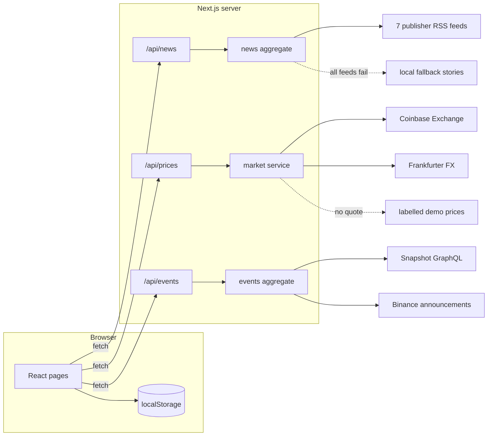
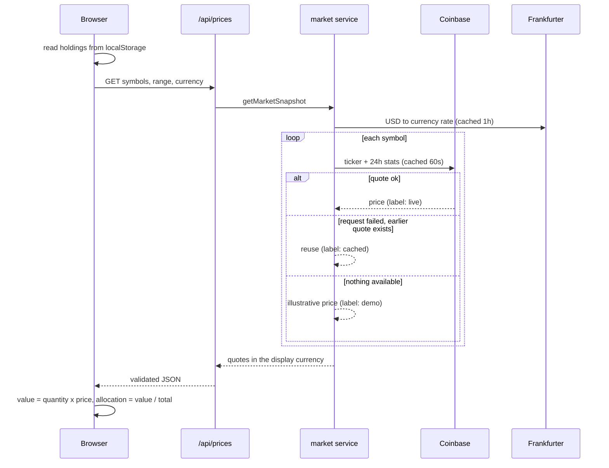

# Architecture

Praxis is a Next.js App Router application with no database and no accounts. Public data is fetched on the server, validated, cached in memory, and served to the browser. Personal data (holdings, journal, saved research, events) never leaves the browser.

## Data flow



The browser never calls a third party directly. Every route validates its response with Zod before returning it, so a malformed upstream payload becomes an empty or fallback response instead of a broken page.

## Key sequence: portfolio value



## Decisions and trade-offs

- **USD as the pricing base, converted centrally.** Coinbase quotes are fetched against `-USD` pairs for every asset, then multiplied by an FX rate from Frankfurter. This gives every asset a live price in six currencies with one provider call per asset, at the cost of the displayed GBP price being a derived number rather than a native GBP order book price.
- **Honest labels over silent fallbacks.** A quote is `live`, `cached` or `demo`. Demo prices exist so the UI works offline, but they are always labelled.
- **In-memory caches, no external store.** News (12 minutes), events (15 minutes), prices (60 seconds) and history (10 minutes) are module-level variables. This keeps the project dependency-free and easy to run, but each server instance (for example each serverless function) has its own cache. See the [shared cache issue](issues/shared-server-cache.md).
- **Browser-only user data.** There is no sync, so there is nothing to breach and nothing to migrate, but data is per browser. Reads are validated with Zod and fall back to a sample rather than crashing on corrupt data.
- **Pure helpers in `lib/`.** Calculation, formatting, sanitising and tagging functions have no framework imports, so they run under `node --test` with no test framework dependency.
- **Feeds are excerpts only.** The app shows the feed's own text, strips it to plain text, and links to the original. It does not scrape article pages or generate summaries.

## Failure modes

| Failure | What the user sees | Where handled |
| --- | --- | --- |
| One news feed times out or errors | Other feeds still shown | `lib/news/aggregate.ts` (per-feed timeout, 8 s) |
| All news feeds fail, earlier result cached | Last good stories, marked cached | `getNews` |
| All news feeds fail, no cache | Built-in fallback stories, marked as cached stories | `data/fallback-news.ts` |
| Coinbase has no pair for an asset | Demo price, labelled Demo | `lib/market/service.ts`, `lib/market/mock.ts` |
| Coinbase request fails | Last quote reused, labelled Cached | `lib/market/service.ts` |
| Frankfurter unreachable | Approximate static FX table | `lib/market/fx.ts` |
| Snapshot or Binance fails | Other source still shown; both failing returns last cache or empty list | `lib/events/aggregate.ts` |
| Corrupt `localStorage` value | Built-in sample or empty state | `lib/storage/local.ts` |
| Upstream payload has an unexpected shape | Empty or fallback response, HTTP 200 | route handlers + `lib/validation/schemas.ts` |

## Folder map

```text
app/                 Routes (App Router). Landing at /, product under /app/*, API under /api/*
  api/{news,prices,events}/route.ts
components/          UI by feature: landing, app-shell, portfolio, news, journal, saved, events, ui
data/                Static data: asset list and colours, currencies, fallback news and demo prices
lib/
  news/              RSS fetching, sanitising, deduplication, tagging
  market/            Coinbase provider, FX, mock prices, service that combines them
  events/            Snapshot and Binance fetchers and aggregation
  portfolio/         Value and allocation maths
  storage/           Validated localStorage helpers
  validation/        Zod schemas shared by routes and storage
tests/unit/          node:test unit tests for pure helpers
scripts/             e2e-smoke.mjs (production smoke test), bench.ts (micro-benchmarks)
docs/                Architecture, data sources, performance notes, issue drafts, screenshots
```
